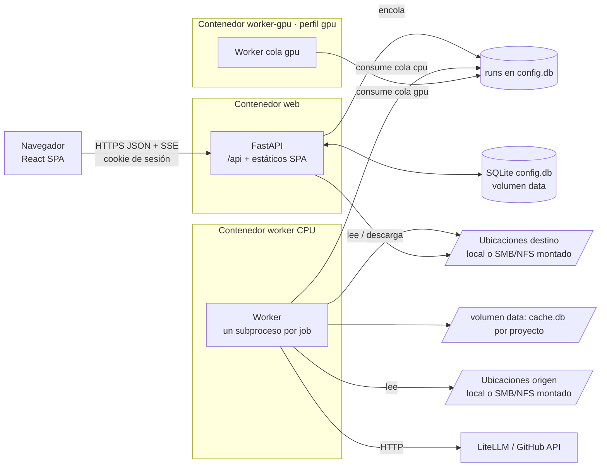

# Arquitectura propuesta

## Vista general



- **Un origen** (como util_bbdd_web): la API sirve la SPA en `/` y la API en `/api`, sin CORS, detrás de un proxy TLS.
- **Una imagen** por variante; `web`, `worker` y `worker-gpu` comparten imagen, volúmenes y secretos.
- **Contrato**: `openapi/openapi.json` → `frontend/src/api/schema.d.ts` (`openapi-typescript` + `openapi-fetch`).
- **SSE en lugar de WebSocket**: hoy doc_organize usa 4 WebSockets (escaneo, dedup, construir/borrar contexto). En la
  web nueva todo es un *run* en cola y el progreso se lee con `GET /api/v1/runs/{id}/events` (SSE). Ventajas: funciona
  con la cookie y el CSRF normales, atraviesa proxies sin configuración extra, se reanuda con `Last-Event-ID` y el job
  **no muere si el usuario cierra la pestaña** (hoy cerrar el WebSocket cancela el escaneo).

## Estructura del monorepo

```text
doc_organize_web/
  backend/
    app/
      core/          # ajustes DOW_* + Docker secrets, logging JSON con request_id, RFC 9457, CSRF, middleware
      db/            # engine SQLite (PRAGMA), modelos SQLAlchemy 2, Alembic, backup/restore
      api/           # /api/health, /metrics; api/v1/ routers finos
      domain/
        identity/    # usuarios, sesiones, auditoría (F1); tenants y roles (F9)
        locations/   # ubicaciones origen/destino, sondeo, explorador de carpetas (F2)
        settings/    # ajustes administrables (F2) y ajustes IA cifrados (F8)
        projects/    # proyectos, miembros, carpetas guardadas (F3/F4)
        runs/        # ejecuciones, artefactos, historial (F3)
        cache/       # lectura paginada de cache.db de cada proyecto (F5)
        duplicates/  # vista previa y resolución (F6)
        context/     # contexto, taxonomías, sitio (F7)
        ai/          # clasificación, manifiestos, uso (F8)
      integrations/doc_organize/   # ÚNICO importador de doc_organize (capa anticorrupción, test de arquitectura)
      jobs/          # worker, cola sobre runs, runner (subproceso), operaciones
      workspace/     # carpetas por ejecución, run.json, ZIP en streaming
      cli.py         # create-admin, rotate-secrets, backup, verify-backup, restore
    alembic/  tests/{unit,api,integration}/  pyproject.toml  uv.lock
  frontend/
    src/{app,api,features,components,i18n,test}/  e2e/  package.json  package-lock.json
  openapi/openapi.json
  docker/{Dockerfile,entrypoint.sh}   docker-compose.yml   docker-compose.dev.yml
  docs/{adr,guides,plan,security}/    zensical.toml
  scripts/{generate_secrets.py,export_openapi.py,load_test.py}
  .ai/  .claude/  .github/  CLAUDE.md  README.md  CHANGELOG.md
```

## Ubicaciones locales y de red (D3)

Concepto nuevo: **Ubicación** = carpeta raíz que un admin registra y que la app puede usar.

| Campo | Ejemplo | Notas |
|---|---|---|
| `name` | `Expedientes NAS` | Visible para usuarios |
| `container_path` | `/mnt/sources/expedientes` | Ruta **dentro del contenedor**; debe existir y estar bajo `DOW_LOCATIONS_ROOT` (`/mnt`) |
| `kind` | `local` \| `network` | Solo informativo + ajustes de robustez (reintentos, timeouts) |
| `usage` | `source` \| `destination` \| `both` | Un proyecto lee de *source* y escribe en *destination* |
| `access` | `ro` \| `rw` | Detectado por sondeo y fijado por el admin; `ro` impide mover duplicados en origen |
| `display_path` | `\\nas01\expedientes` | Texto para el usuario; nunca se usa para acceder |
| `visibility` | `global` \| (F9) `tenant` | |

Reglas:

1. **Montaje fuera de la app**: SMB/NFS se montan en el host o como volumen de compose
   (`driver: local`, `driver_opts: type=cifs|nfs`); credenciales en el host o en `.env`/secretos de compose, nunca en
   `config.db`. Se documentan ejemplos para Linux y para Docker Desktop en Windows (ver riesgos R1).
2. **Allowlist estricta**: toda ruta que llega por API se resuelve (`Path.resolve(strict=True)`), se comprueba que
   está dentro de una ubicación permitida **después** de resolver enlaces simbólicos, y la autorización se evalúa
   antes que la existencia (se conserva la protección actual contra el oráculo de existencia de directorios).
3. **Sondeo** (`POST /locations/{id}/probe`, también periódico): existe, legible, escribible (fichero temporal),
   latencia de `stat`, espacio libre. Estado `ok | degraded | unavailable` visible en la UI y en `/api/health`.
4. **SQLite nunca en red**: `cache.db` (WAL) y `config.db` viven en el volumen local `data`
   (`/data/projects/<project_id>/cache.db`). WAL no funciona de forma fiable sobre SMB/NFS. Las salidas (Markdown,
   JSON, imágenes, duplicados, sitio) sí van al destino, que puede ser de red. Requiere que la librería separe rutas
   (hueco G5).
5. **Robustez en red**: reintentos con *backoff* ante `OSError` transitorios (`EIO`, `ETIMEDOUT`, `ESTALE`), timeout por
   documento, nada de `inotify` (no funciona en SMB): los cambios se detectan por escaneo incremental
   (tamaño + mtime antes de hashear).
6. **Origen de solo lectura**: la deduplicación ofrece «solo informe» o «copiar a cuarentena en destino» en lugar de
   «mover» (hueco G6).

## Modelo de datos (config.db, Alembic)

Fase 1–3 (núcleo): `tenants` (fila `default`, preparada para F9), `users`, `sessions`, `audit_log`, `locations`,
`app_settings` (ajustes administrables, clave/valor tipado), `projects` (`tenant_id`, `name`, `source_location_id`,
`source_subpaths`, `destination_location_id`, `destination_subpath`), `project_members`, `scanned_folders`, `runs`
(cola: `status`, `queue` cpu/gpu, `operation`, `params` JSON, `progress`, `cancel_requested`, `heartbeat_at`),
`artifacts`, `workers`.

Fases posteriores: `ai_settings` (secreto Fernet por familia, F8), `taxonomy_templates` (las personalizadas, F7),
`roles` y `role_permissions` (F9).

Portabilidad a otra BD (D8): solo tipos de SQLAlchemy (`JSON`, `DateTime(timezone=True)`, `Uuid`), nada de SQL crudo
salvo el reclamo de la cola (`UPDATE … RETURNING`, válido en SQLite ≥ 3.35 y PostgreSQL), PRAGMA solo en el
*listener* de conexión, y un test de migraciones `upgrade`/`downgrade` en CI. Cambiar de motor = URL + driver.

## Ejecuciones (jobs)

Mismo diseño que ADR-002 de util_bbdd_web (cola propia sobre `runs`, subproceso *spawn* por job, latido,
cancelación, timeouts, huérfanos). Operaciones:

| Operación | Cola | Llama a (doc_organize) | Escribe |
|---|---|---|---|
| `scan` | cpu / gpu (si OCR GPU) | `ScanCommand.run_streaming` | destino + `cache.db` |
| `dedup_preview` | cpu | `DeduplicationManager.find_duplicates` | artefacto JSON |
| `dedup_apply` | cpu | `DeduplicationManager.resolve_duplicates` (grupos revisados) | destino (+ origen si `rw`) |
| `context_build` | cpu | `ContextBuilder.build` + `Reorganizer` + `SiteGenerator` (Zensical, L-8) | destino |
| `context_delete` | cpu | `Reorganizer.delete_output` + `SiteGenerator.delete_site` | destino |
| `taxonomy_draft` | cpu | `taxonomy_manifest_draft_client` | artefacto |
| `export_zip` / `export_xlsx` | cpu | exportadores de la librería (hueco G8) | workspace |
| `history_clear` | cpu | `ProjectHistoryCleaner.clear` | destino |
| `noop` | cpu | — | prueba del motor (F3) |

Un proyecto admite **una operación de escritura a la vez** (bloqueo en BD, sustituye al `set` en `app.state` que hoy
depende del GIL — ADR-004 de doc_organize queda obsoleto).

## Configuración (variables `DOW_*`)

| Variable | Por defecto | Uso |
|---|---|---|
| `DOW_ENVIRONMENT` | `production` | `development` habilita `/api/docs` y quita `__Host-` en cookies |
| `DOW_DATA_DIR` | `/data` | `config.db`, `projects/<id>/cache.db` |
| `DOW_WORKSPACE_DIR` | `/workspace` | Artefactos por ejecución (exportaciones, informes) |
| `DOW_LOCATIONS_ROOT` | `/mnt` | Única raíz donde puede haber ubicaciones |
| `DOW_MODELS_DIR` | `/models` | Modelos de Docling/RapidOCR/EasyOCR/Whisper precargados (sin Internet en runtime) |
| `DOW_STATIC_DIR` | `/app/static` | Build de la SPA |
| `DOW_WORKER_QUEUES` | `cpu` | Colas que atiende un worker (`gpu` en `worker-gpu`) |
| `DOW_WORKER_CONCURRENCY` | `1` | Jobs simultáneos (Docling es intensivo en memoria) |
| `DOW_JOB_TIMEOUT_SECONDS` | `21600` | Duración máxima de un job (6 h) |
| `DOW_DOCUMENT_TIMEOUT_SECONDS` | `600` | Timeout por documento al convertir |
| `DOW_NETWORK_RETRIES` | `3` | Reintentos ante errores de E/S transitorios |
| `DOW_SESSION_*`, `DOW_LOGIN_*`, `DOW_PASSWORD_MIN_LENGTH`, `DOW_RATE_LIMIT_*` | como UBW | Identidad y seguridad |
| `DOW_RUN_RETENTION_DAYS`, `DOW_USER_QUOTA_MB` | `30`, `0` | Retención y cuota de workspace; administrables |
| Secret `dow_app_secret_key` | — | Firma CSRF; obligatorio en producción |
| Secret `dow_fernet_keys` | — | Cifrado de ajustes IA (lista para rotación); obligatorio |
| Secret `dow_metrics_token` | — | Activa `/metrics` |

Precedencia de ajustes administrables: valor en `app_settings` > variable de entorno > valor por defecto (como
ADR-012 de util_bbdd_web). Para las credenciales IA: `ai_settings` (cifrado) > variable `DOC_ORGANIZE_*` (compatible
con la librería).

## Docker (D6)

Dockerfile multi-stage con *build args*, como util_bbdd_web:

| Target / arg | Contenido | Tamaño orientativo |
|---|---|---|
| `frontend-build` | Node 24, `npm ci`, `vite build` | — |
| `runtime` (por defecto, CPU) | Python 3.12-slim, doc_organize `[rapidocr,ai,context,export,site]`, `libmagic1`, modelos Docling precargados en `/models` | PENDIENTE DE MEDIR |
| `WITH_LIBREOFFICE=true` | `libreoffice-calc-nogui` (`soffice` para `.xls`) | +~300 MB |
| `WITH_AV=true` | extra `av` (`docling[asr]`), `ffmpeg`, modelo Whisper precargado | +~1 GB |
| `runtime-gpu` | base `nvidia/cuda:<ver>-runtime`, extra `ocr-gpu` (torch, easyocr), servicio `worker-gpu` con `deploy.resources.reservations.devices` | +~5 GB |
| `backend-dev` | uv, ruff, mypy, pytest (CI y desarrollo sin uv local) | — |

Endurecimiento heredado: usuario no root (uid 10001), `read_only: true` + `tmpfs` (`/tmp`, cachés de HF/torch apuntadas
a `/models` de solo lectura), `cap_drop: ALL`, `no-new-privileges`, healthcheck sobre `/api/health`.

## Frontend

- Vite + React 19 + TypeScript estricto, React Router, TanStack Query, Mantine, React Hook Form + Zod, i18next (es).
- `features/`: `auth`, `admin` (usuarios, sesiones, auditoría, ajustes, tenants/roles en F9), `locations`, `projects`,
  `scan`, `runs`, `cache`, `duplicates`, `context`, `taxonomies`, `ai`, `health`.
- Componentes compartidos: explorador de carpetas (sustituye a `_folder_browser_macros`), semáforo de estado
  (sustituye a `_semaforo_macros`), banner de estado, visor Markdown/JSON saneado, progreso de run con `aria-live`,
  tablas virtualizadas para cachés grandes.
- Mapeo de pantallas actuales (20 plantillas Jinja) → rutas React en `ROADMAP.md`.
